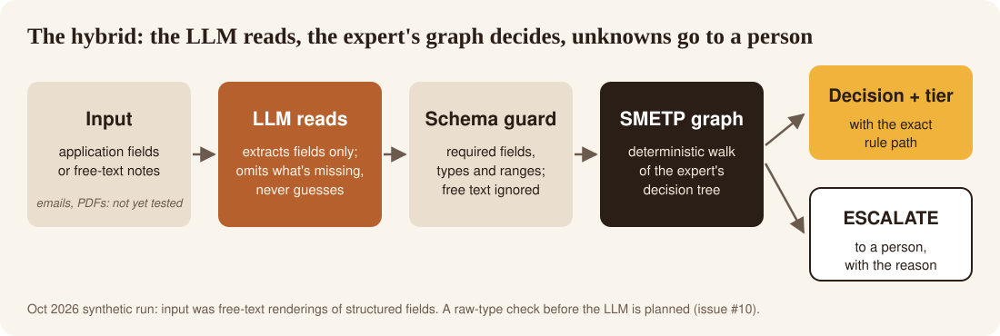

<div align="center">

# SMETP

### Subject Matter Expertise Transfer Protocol

**Capture how your best expert decides. Make it testable.<br>Let the LLM read. Let the expert's rules decide.**

An open, MIT-licensed method for interviewing a subject-matter expert and writing down their decision logic (inputs, thresholds, edge cases, confidence, and when to escalate) as a tree you can validate and run.

[](LICENSE)
[](docs/benchmarks/2026-10-credit-risk.md)
[](#how-it-works)
[](docs/benchmarks/methodology-review.md)

[**ieataiforbreakfast.com**](https://ieataiforbreakfast.com) · [Pitch deck (Google Slides)](https://docs.google.com/presentation/d/1f7bCEAktVLKlUVZo5MYdazvQvN-8L3me0Zp4V01mn_Q/edit) · [Benchmark report](docs/benchmarks/2026-10-credit-risk.md) · [Get started](GETTING_STARTED.md)

*Augment experts, don't replace them.*

</div>

---

## How it works

<p align="center">
  <picture>
    <source media="(max-width: 640px)" srcset="docs/assets/hybrid-flow-vertical.svg">
    
  </picture>
</p>

**Input → LLM extracts fields → schema guard → SMETP graph → decision + tier with the rule path, or ESCALATE to a person.**

1. **Capture.** Interview the expert with the [templates](templates/) and write their logic down as a decision tree with inputs, outcomes, and confidence ([`FRAMEWORK.md`](FRAMEWORK.md)).
2. **Read.** An LLM pulls structured fields out of the application. It is told to omit anything not stated and never guess.
3. **Decide.** The graph walks the expert's tree deterministically. Same input, same output, with the exact path it took.
4. **Escalate.** Missing, invalid, or out-of-range input goes to a person, with the reason. The graph never reads free text, so instructions planted in a notes field cannot change its rules.

> In the October 2026 run, the "messy" input was free-text renderings of structured fields. Emails and PDFs are the intended use but were not tested. The LLM parser also quietly fixed bad input types before the guard saw them, which caused all four hybrid misses. A raw-type check ahead of the parser is planned in [#10](https://github.com/goker/SMETP-Subject-Matter-Expertise-Transfer-Protocol/issues/10).

## Results at a glance

On one synthetic run, the hybrid reached the same 97.1% decision accuracy as pasting the expert's docs into the prompt. It cost $0.36 instead of $2.29 for 139 decisions, with a 2.5 s median instead of 16.8 s, and every decision carried a rule path.

| Setup | Decisions correct | Rule cited† | Median latency | Cost (139) |
|---|---|---|---|---|
| **Hybrid: LLM parses, SMETP graph decides** | **97.1%** | **100%** | **2.5 s** | **$0.36** |
| LLM + expert docs in prompt | 97.1% | 90.6% | 16.8 s | $2.29 |
| Plain LLM (no-policy control) | 30.2% | 3.6% | 8.7 s | $0.87 |
| SMETP graph alone (structured input) | 100%\* | 100% | ~0.008 ms | $0 |

<sub>139 synthetic credit-risk cases built from [`examples/finance_credit_risk_assessment.json`](examples/finance_credit_risk_assessment.json) · grok-4.7 · 1 scored run per case · total spend $4.67.<br>
\*By construction: the test answers come from an oracle of the same expert tree. It shows faithful capture, not a smarter system.<br>
†Counts whether a rule was named, not whether it was the right one.<br>
Synthetic data, one domain, one model, one run per case. The two 97.1% scores are one sample, not proof the setups are equivalent.<br>
Methodology review: three LLM judges, majority verdict **"partially"**. One judge said industry-standard, only as a synthetic expert-policy evaluation. Not regulated credit-model validation.</sub>

## Try it

- **Capture an expert by hand.** Follow [`GETTING_STARTED.md`](GETTING_STARTED.md) with the interview [templates](templates/).
- **Re-run the benchmark graph offline.** Frozen harness with SHA-256 hashes, standard-library Python, no API key: [`benchmarks/2026-10-credit-risk/`](benchmarks/2026-10-credit-risk/README.md).
- **Check how it was measured.** [Methods](docs/benchmarks/2026-10-credit-risk-methods.md) · [Methodology review](docs/benchmarks/methodology-review.md) · [Full report](docs/benchmarks/2026-10-credit-risk.md)
- **See the pitch.** [Pitch deck (Google Slides)](https://docs.google.com/presentation/d/1f7bCEAktVLKlUVZo5MYdazvQvN-8L3me0Zp4V01mn_Q/edit)
- **Visit the site.** [ieataiforbreakfast.com](https://ieataiforbreakfast.com) · [Discovery (free)](https://ieataiforbreakfast.com/discover)
- **Free demo — coming on ieataiforbreakfast.com.** Not live yet.
- **Tell us what to capture next.** Open an Issue with the domain-request template.

```bash
git clone https://github.com/goker/SMETP-Subject-Matter-Expertise-Transfer-Protocol
cd SMETP-Subject-Matter-Expertise-Transfer-Protocol/benchmarks/2026-10-credit-risk
sha256sum -c SHA256SUMS
cp -rL . /tmp/smetp-bench && cd /tmp/smetp-bench    # the scripts write into the current folder
python3 kg.py | diff - kg_validation.txt && echo "graph output reproduces"
```

## What's here, and what isn't

**In this repo today**

- The method: [`FRAMEWORK.md`](FRAMEWORK.md), [`GETTING_STARTED.md`](GETTING_STARTED.md)
- Interview templates in [`templates/`](templates/)
- Three worked examples (JSON): finance credit risk, healthcare differential diagnosis, legal contract risk. See [`examples/README.md`](examples/README.md).
- The October 2026 credit-risk benchmark: [report](docs/benchmarks/2026-10-credit-risk.md), [methods](docs/benchmarks/2026-10-credit-risk-methods.md), [frozen harness](benchmarks/2026-10-credit-risk/README.md), [methodology review](docs/benchmarks/methodology-review.md)
- A hand-written **draft** Agent Skills file for the credit-risk example: [`examples/credit-risk/SKILL.md`](examples/credit-risk/SKILL.md). It is an example compile target, not a shipped product.

**Not shipped yet (roadmap)**

- A JSON Schema + validator for skill files
- Compile to Agent Skills `SKILL.md` (credit-risk draft is in-repo; no compiler yet)
- An MCP server exposing `decide` / `explain` / `validate`
- Healthcare and legal benchmarks

There are **no published npm packages** and **no drop-in adapters** for Claude, ChatGPT,
Gemini or other tools yet. We'll update this section when they exist.

---

## What the benchmark found in the example

Encoding the example as a graph also found bugs in it (2 of 5 published test cases contradict
the tree; a bankruptcy check never runs at scores of 650+; undeclared fields). Tracked here:

- [#14](https://github.com/goker/SMETP-Subject-Matter-Expertise-Transfer-Protocol/issues/14) — published test "bankruptcy 8 years ago, score 700" expects CONDITIONAL/SUBPRIME; the tree returns APPROVE/STANDARD
- [#3](https://github.com/goker/SMETP-Subject-Matter-Expertise-Transfer-Protocol/issues/3) — published test "self-employed, 3 years" expects CONDITIONAL; the tree returns APPROVE
- [#4](https://github.com/goker/SMETP-Subject-Matter-Expertise-Transfer-Protocol/issues/4) — `check_recent_bankruptcy` never runs at scores of 650+
- [#5](https://github.com/goker/SMETP-Subject-Matter-Expertise-Transfer-Protocol/issues/5) — `has_2yr_tax_returns` and `tax_return_trend` are tested but not declared
- [#6](https://github.com/goker/SMETP-Subject-Matter-Expertise-Transfer-Protocol/issues/6) — reason text on `deny_credit_seeking` and `deny_high_dti` does not match the branch
- [#7](https://github.com/goker/SMETP-Subject-Matter-Expertise-Transfer-Protocol/issues/7) — DENY and ESCALATE outcomes have no confidence
- [#8](https://github.com/goker/SMETP-Subject-Matter-Expertise-Transfer-Protocol/issues/8) — five heuristics and six edge cases are prose only
- [#9](https://github.com/goker/SMETP-Subject-Matter-Expertise-Transfer-Protocol/issues/9) — score 780 with DTI 80%, zero savings, and 5 inquiries is approved PRIME

Benchmark follow-up: [#10](https://github.com/goker/SMETP-Subject-Matter-Expertise-Transfer-Protocol/issues/10).
Roadmap: [#11](https://github.com/goker/SMETP-Subject-Matter-Expertise-Transfer-Protocol/issues/11) harness (published in `benchmarks/2026-10-credit-risk/`), [#12](https://github.com/goker/SMETP-Subject-Matter-Expertise-Transfer-Protocol/issues/12) SKILL.md compiler, [#13](https://github.com/goker/SMETP-Subject-Matter-Expertise-Transfer-Protocol/issues/13) MCP server.

## Before you quote anything

- Notes under [`docs/reference-implementation/`](docs/reference-implementation/) are a handoff plan for a future codebase. They are not install instructions, and this repository has no package tree.
- Example JSON files still contain validation fields from earlier drafts. Those fields are not measurements. Read [`examples/README.md`](examples/README.md) before quoting anything inside an example.
- GitHub Discussions are not enabled on this repo yet. Paste-ready posts are in [`docs/benchmarks/discussions-draft.md`](docs/benchmarks/discussions-draft.md).

## License

MIT License - See [LICENSE](LICENSE) for details.

Built by Goker Ezberci.

Questions and corrections: GitHub Issues. Email: contact@ieataiforbreakfast.com
