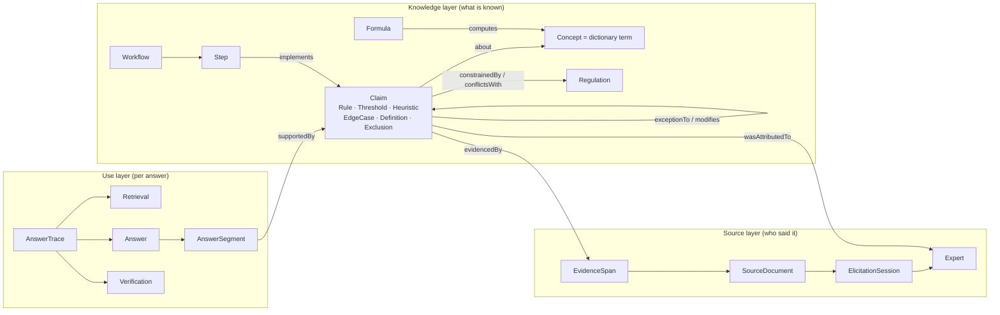
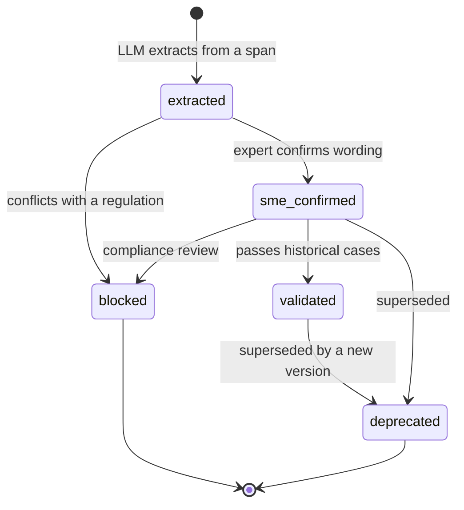

# Knowledge Graph and Traceable Answers

**Status:** draft proposal, SMETP Knowledge Ontology 0.1.0, targeting `@smetp/spec` 0.6.0 (additive).
**Author:** Goker Ezberci. **License:** MIT, like the rest of this repository.

SMETP already turns an expert's tacit knowledge into a `SkillDocument` that a runtime can execute. This document adds the layer that makes that knowledge **traceable once it is inside an LLM**: a typed ontology, a claim-level knowledge graph with hashed evidence, a vendor-neutral answer trace, a deterministic verifier, and a viewer that shows the path from any sentence back to the moment an expert said it.

The one-line idea: **the Claim is the unit of transfer, the unit of citation, and the unit of credit.**

```text
Answer sentence ──supportedBy──▶ Claim ──evidencedBy──▶ EvidenceSpan ──spanOf──▶ Transcript ──▶ Session ──▶ Expert
                                   │
                                   ├─about──────▶ Concept (dictionary term)
                                   ├─implemented by──▶ Workflow Step (executed by @smetp/runtime)
                                   ├─exceptionTo──▶ Rule      (edge cases travel with their rules)
                                   └─constrainedBy / conflictsWith──▶ Regulation
```

Everything in this folder is runnable today:

| Artifact | Path |
|---|---|
| Ontology (OWL/RDFS, aligned to PROV-O and SKOS) | [`ontology/smetp.ttl`](../ontology/smetp.ttl) |
| JSON-LD context (JSON graph becomes linked data) | [`ontology/context.jsonld`](../ontology/context.jsonld) |
| Integrity rules (SHACL) | [`ontology/shapes.ttl`](../ontology/shapes.ttl) |
| JSON Schemas for graph and trace | [`schemas/`](../schemas) |
| Example graph: two experts, 17 claims, hashed spans | [`examples/graph/credit_risk.graph.json`](../examples/graph/credit_risk.graph.json) |
| Example verified trace (with a caught hallucination) | [`examples/traces/credit_risk.trace.json`](../examples/traces/credit_risk.trace.json) |
| Zero-dependency toolkit: retrieve, prompt, ask, verify | [`tools/smetp-trace/`](../tools/smetp-trace) |
| Interactive trace viewer (single HTML file) | [`viewer/trace-viewer.html`](../viewer/trace-viewer.html) |

---

## 1. Why this layer

Reading the reference implementation at ieataiforbreakfast.com, SMETP v0.5 gets three things right: knowledge is captured with elicitation provenance, workflows execute deterministically, and the Twin refuses to answer without citing a workflow step or dictionary term. Four things still break the chain between an answer and the expert:

1. **Heuristics, edge cases and concepts are plain strings** in `SkillDocument` (`heuristics: string[]`, `edge_cases: string[]`, `concepts: string[]`). They have no ids, so an LLM cannot cite them, and the most valuable tacit knowledge is the least traceable.
2. **Evidence stops at the interview.** `kg_edges.evidence_interview_id` and `Workflow.source_refs: string[]` point to a whole interview. Nobody can show *which sentence* of the expert supports a rule, or prove the transcript was not edited later.
3. **The graph and the portable document are two disconnected representations.** The hosted Postgres graph (concept, formula, regulation, workflow, dictionary tables) does not travel with the skill package, and the package does not carry the graph.
4. **LLM citations are requested, then trusted.** `lib/twin/ask.ts` asks the model to cite step or term ids and rejects answers with zero citations, but never checks that the cited ids exist or support the sentence.

This proposal closes all four while staying compatible with v0.5 documents.

## 2. Design principles

1. **Atomic claims.** Each piece of expertise is one reified, versioned assertion with an id. Atomicity is what lets a sentence cite exactly what it relies on (the same move FActScore makes for evaluation and nanopublications make for scientific facts).
2. **No evidence, no claim.** Every claim points to at least one character-offset span in a source document, with a SHA-256 of the exact text. Hashes make tampering and transcript drift detectable without publishing the transcript.
3. **Status is a gate.** Claims move `extracted → sme_confirmed → validated`, or to `blocked` / `deprecated`. Only eligible claims reach a model. A claim that conflicts with a regulation is blocked by rule.
4. **Rules travel with their exceptions.** Retrieval that returns a rule must also return every edge case that is `exceptionTo` it and every heuristic that `modifies` it. Most expert errors are edge-case errors.
5. **Dictionary terms are concepts.** One SKOS concept carries the canonical label, synonyms, abbreviations and definition. This merges `concept_nodes` and `dictionary_entries` and gives retrieval its seed vocabulary.
6. **Workflows are citation paths.** Every workflow step names the claims it implements, so a deterministic run is already a trace.
7. **Model-agnostic by construction.** The contract is plain JSON in and JSON out. Claude, GPT, Gemini, Llama via Ollama, or a fine-tuned model all plug in the same way, and the verifier trusts none of them.
8. **Verification is deterministic first.** Id existence, eligibility, number grounding, and execution tracing are checked with code. Semantic entailment is an optional second pass, never the only one.

## 3. The ontology

Three layers in one graph. Full definitions: [`ontology/smetp.ttl`](../ontology/smetp.ttl).



### Alignment with existing standards

| SMETP class | Aligned to | Why it matters |
|---|---|---|
| `Expert` | `prov:Person` | Attribution and credit use the W3C provenance model, so any PROV tool can read the graph. |
| `ElicitationSession`, `AnswerTrace`, `Retrieval`, `Verification` | `prov:Activity` | Capture and answering are both activities with inputs, outputs and agents. |
| `Claim`, `EvidenceSpan`, `SourceDocument`, `Answer` | `prov:Entity` | `evidencedBy` is a sub-property of `prov:wasDerivedFrom`. |
| `Concept` | `skos:Concept` | `prefLabel`, `altLabel`, `notation`, `definition`, `broader` replace bespoke dictionary columns. |
| `Workflow` | `prov:Plan` | A workflow is the plan the runtime follows. |
| Claim with provenance + publication info | Nanopublication pattern | One citable unit per fact, as proposed for knowledge-graph citation. |

### Typed relations

The current `kg_edges.relation` column is free text. The ontology fixes a small vocabulary so retrieval and verification can reason over it:

| Relation | From → To | Used by |
|---|---|---|
| `about` | Claim → Concept | Retrieval seeds claims from concepts in the question. |
| `dependsOn`, `skos:broader` | Concept → Concept | k-hop expansion (DTI depends on monthly debt and income). |
| `computes`, `usesVariable` | Formula → Concept | Numeric grounding of computed sentences. |
| `exceptionTo` | EdgeCase → Rule/Threshold | Rule-with-exceptions retrieval. |
| `modifies` | Heuristic → Claim | Pulled in alongside the claim it adjusts. |
| `constrainedBy`, `conflictsWith` | Claim → Regulation | Compliance gate; `conflictsWith` forces `blocked`. |
| `contradicts` | Claim ↔ Claim | Contradiction log becomes queryable; two live contradicting claims raise a warning. |
| `supersedes` | Claim → Claim | Versioning without editing history. |
| `implements` | Step → Claim | Workflow runs become citation paths. |
| `supportedBy` | AnswerSegment → Claim | The trace itself. |

### Claim lifecycle



Retrieval uses a **trust floor** (default `sme_confirmed`). Extracted claims are visible to reviewers and invisible to models until confirmed.

## 4. Retrieval: a context pack for any model

`buildContextPack(graph, question)` in [`tools/smetp-trace/lib.mjs`](../tools/smetp-trace/lib.mjs):

1. **Seed.** Match concept labels, synonyms and abbreviations in the question (the dictionary does the grounding). Production systems add embedding and trigram matches; the hosted graph already has `pgvector` and `pg_trgm` indexes for this.
2. **Expand** k hops over `dependsOn` and `broader`, in both directions.
3. **Collect** claims `about` any concept in the set.
4. **Close over exceptions.** Repeatedly add claims that are `exceptionTo` or `modifies` a collected claim.
5. **Always include Exclusions,** so the model can refuse correctly.
6. **Gate.** Drop `blocked`, `deprecated`, and below-floor claims, and record why in `excluded`.
7. **Attach** regulations the claims are `constrainedBy` and workflows whose steps implement them.
8. **Hash** the pack, so the trace can prove what the model was shown.

This is GraphRAG-style local retrieval with two SMETP-specific moves: exception closure and the status gate. In the example, a question mentioning a 25-year-old applicant still never shows the model the blocked age-based heuristic.

## 5. The Cite-or-Refuse contract

The prompt (`renderPrompt`) is the same for every vendor. The model returns:

```json
{
  "segments": [
    { "text": "DTI is 35% ($2,100 / $6,000), under the 43% ceiling for the standard tier.",
      "kind": "computed", "claims": ["c:dti-definition", "c:dti-ceiling"], "bindings": ["dti"] },
    { "text": "I can't recommend an interest rate; pricing is outside this expertise.",
      "kind": "refusal", "claims": ["c:excl-pricing"] }
  ]
}
```

Rules: one sentence per segment; cite only ids from the pack; every number comes from the question, a cited claim, or a reported workflow binding; unsupported sentences are marked or omitted; exclusions produce refusals; edge cases are checked before their rules are applied.

Kinds: `entailed` (restates a claim), `computed` (reports a workflow or formula result), `synthesized` (combines claims), `refusal` (cites an Exclusion), `unsupported`.

## 6. Verification and Trace Assurance Levels

`verifyTrace(graph, trace)` re-derives every verdict from the graph. Per sentence:

| Check | Failure |
|---|---|
| Every cited id exists | `unknown_claim` |
| No cited claim is blocked or deprecated | `ineligible_claim` |
| Non-refusal sentences cite something | `unsupported_segment` |
| Every number is grounded (percentages normalized, `43%` = `0.43`) | `unsupported_number` |
| Computed sentences trace to an executed step that implements a cited claim | `computation_not_traced` |
| Cited claims were in the context pack | `not_in_context` (warning) |
| Sentence mentions a concept the claim is about | `weak_anchor` (warning) |
| Refusals cite an Exclusion | `refusal_without_exclusion` (warning) |

Each sentence gets a **Trace Assurance Level (TAL)** equal to its weakest cited claim:

| TAL | Meaning |
|---|---|
| 0 | Unsupported, invented id, ineligible claim, or ungrounded number |
| 1 | Cites a real node, but its evidence hashes do not verify |
| 2 | Evidence spans verify against the source text |
| 3 | Claims are SME-confirmed by a named expert |
| 4 | Claims are validated against historical cases |

Answer-level metrics: `grounded_ratio`, `mean_tal`, `min_tal`, `citation_validity`, `unsupported_numbers`, and a verdict (`pass`, `pass_with_warnings`, `fail`). Products can set policy on them, for example "show the answer only if `min_tal >= 3`, otherwise route to a human."

**Semantic pass (optional).** Deterministic checks catch invented ids and numbers but not a real claim cited for something it does not say. Add a judge per segment: input the sentence and the cited claim statements, output `entails | partial | contradicts | unrelated`. An NLI model is cheaper and more stable than an LLM judge; either way, the judge's verdict is recorded in the trace and can only lower a TAL, never raise it.

In the example trace the verifier catches an invented claim id (`c:default-rate-band`) and an invented statistic ("less than 2%") in the same sentence, while the other five sentences reach TAL 3 or 4.

## 7. Plugging the graph into any LLM

Three integration modes, from lightest to strongest:

**A. Prompt pack (any chat UI, any model).** `cli.mjs context graph.json "question"` prints the pack and contract. Paste it into any model, save the JSON reply, then `cli.mjs ask ... --response reply.json` verifies it offline.

**B. Direct API.** `cli.mjs ask` calls Anthropic, OpenAI, or any OpenAI-compatible endpoint (Ollama, vLLM, LM Studio, Gemini's compatibility API), then verifies. Same graph, same contract, comparable traces across vendors. This is also the cleanest way to run the `/proof` benchmark across models.

**C. MCP server (agents).** Expose the graph as a Model Context Protocol server so any MCP client (Claude, ChatGPT, IDE agents) can use it as tools. Proposed tool surface for `@smetp/runtime`'s MCP descriptor:

| Tool | Input | Output |
|---|---|---|
| `smetp_search_concepts` | `query` | concepts with ids, labels, definitions |
| `smetp_context_pack` | `question`, `hops?`, `floor?` | the pack from section 4 |
| `smetp_get_claim` | `id` | statement, status, evidence spans, expert |
| `smetp_neighborhood` | `id`, `hops` | typed subgraph around a node |
| `smetp_run_workflow` | `workflow_id`, `inputs` | bindings plus executed step ids |
| `smetp_verify_answer` | `question`, `segments` | verification block and TAL per sentence |

Graph files and claims also map naturally to MCP resources (`smetp://kg/{id}/claims/{claim}`). The final answer is only shown after `smetp_verify_answer` passes the product's policy.

**Observability.** Emit each trace as OpenTelemetry spans using the GenAI semantic conventions (still at Development stability): `retrieval smetp-kg` with `gen_ai.data_source.id` set to the graph id, `execute_tool` for workflow runs, and the model `chat` span. Attach `smetp.trace.id`, `smetp.min_tal` and `smetp.grounded_ratio` as span attributes so existing LLM observability tools can filter on traceability.

## 8. Visualization

[`viewer/trace-viewer.html`](../viewer/trace-viewer.html) is one self-contained file. It lays the chain out left to right (answer, claims, knowledge, evidence, source), draws the links, and lights up the full path of whatever you select. Selecting a claim shows its transcript span highlighted in context and re-computes the span's SHA-256 in the browser. Claims kept out of the model's context (blocked, unconfirmed) are shown with the reason, which is often the most persuasive part of the demo. Load any graph and verified trace with the file pickers, or rebuild the embedded example with `node viewer/build.mjs`.

For the hosted product, the same layout fits on `/twin/[id]` as a "Why?" drawer under each answer, and the knowledge map on `/graph` can reuse the typed relations for edge styling.

## 9. Measuring knowledge transfer

Traceability makes transfer measurable at three points:

| Stage | Metric | Definition |
|---|---|---|
| Capture | **Transfer yield** | Share of transcript characters covered by at least one eligible claim's spans. Low yield means the interview talked around the decisions. |
| Capture | **Confirmation rate** | Confirmed claims / extracted claims. |
| Capture | **Decision coverage** | Share of an ontology pack's `canonical_decisions` with at least one Rule claim. |
| Curation | **Contradiction density** | Live `contradicts` pairs per 100 claims. |
| Curation | **Compliance block rate** | Blocked claims / all claims, by regulation. |
| Use | **Grounded ratio**, **mean TAL**, **citation validity** | From the verifier, per answer and aggregated per Twin. |
| Use | **Cold-claim share** | Eligible claims never cited in N days. Candidates for re-elicitation or retirement. |

These slot directly into the Twin `validation_manifest` (`cited_evidence_rate` becomes `grounded_ratio`) and into `monitoring.re_elicitation_triggers`.

## 10. Credit and knowledge royalties

Each grounded sentence carries one unit of credit, split evenly across its valid cited claims and assigned to each claim's `attributed_to` expert. Summed over answers, this gives a defensible usage share per expert, which is exactly what the "extract once, earn forever" model needs: payouts based on which expert's knowledge actually answered questions, auditable down to the transcript span. In the example, Jane Doe earns 90% and Sam Rivera 10%, because one sentence used Sam's self-employment exception.

Even splitting is the simplest defensible rule. Weighting by claim confidence or by support kind are reasonable refinements, and the trace keeps enough data to recompute credit under any rule later.

## 11. What the example demonstrates

The example graph re-models `examples/finance_credit_risk_assessment.json` as claims, and the ontology surfaces problems the flat JSON hides:

- **Marital status** ("married co-applicants are more stable") and **age** ("25 to 35 with rising income") heuristics conflict with ECOA / Regulation B. Both are `blocked` and never reach a model. The age heuristic carries a note to re-elicit it as an income-trajectory signal.
- **The bankruptcy rationale** ("FCRA says bankruptcies drop off after seven years") is a factual misstatement: FCRA section 605 allows bankruptcies to be reported for up to ten years. The rationale is blocked while the seven-year approval policy itself stays valid.
- **The 43% DTI ceiling** is kept as internal policy with a review note: it mirrors the original General QM cap, which the 2020 ATR/QM amendments replaced with a price-based test.
- **Medical debt at 50%** stays `extracted` until an SME confirms it, so it is visible to reviewers and invisible to models.

The original example file uses the same heuristics; it should be reviewed with these findings in mind.

## 12. Gap analysis against the reference implementation

Concrete changes for the ieataiforbreakfast.com codebase, in priority order:

| # | Where | Today | Change |
|---|---|---|---|
| 1 | `lib/twin/ask.ts`, `askLlmConstrained` | Rejects zero-citation answers but accepts any cited id | Run `verifyTrace` on every LLM answer. Reject unknown ids and ungrounded numbers. Return TAL per sentence to the UI. |
| 2 | `lib/twin/ask.ts`, `matchesRefuseTopic` | Matches only the first word of each refuse topic, so a topic like "credit pricing" refuses every question containing "credit" | Model refuse topics as Exclusion claims about concepts and match on concept seeds. |
| 3 | `@smetp/spec` `SkillDocument` | `heuristics`, `edge_cases`, `concepts` are `string[]` | Add `claims: ClaimSchema[]` (additive, v0.6). Keep strings for back-compat; the compiler emits both. |
| 4 | `@smetp/spec` `WorkflowStepSchema` | Steps have no link to knowledge | Add optional `implements: string[]` to `StepBase`. |
| 5 | `db/migrations` | Evidence is `evidence_interview_id` | Add `evidence_spans` and `claims` tables, and `answer_traces` for persisted traces (sketch below). |
| 6 | `concept_nodes` + `dictionary_entries` | Two tables linked by `refines_concept` | Treat dictionary entries as SKOS labels on concepts; keep the table as a view during migration. |
| 7 | `kg_edges.relation` | Free text | Constrain to the relation vocabulary in section 3. |
| 8 | Skill package (`references/`) | Graph is product-only | Ship `references/knowledge.graph.json` (claims, concepts, spans with hashes, optionally without source text) so the package is traceable offline. |
| 9 | `/twin/[id]` | Trust strip shows source type | Add the per-sentence TAL badges and a "Why?" drawer using the viewer layout. |

Migration sketch (Postgres):

```sql
CREATE TABLE evidence_spans (
  id            UUID PRIMARY KEY DEFAULT gen_random_uuid(),
  tenant_id     UUID,
  interview_id  UUID REFERENCES interviews (id) ON DELETE CASCADE,
  message_id    UUID,
  start_char    INTEGER NOT NULL,
  end_char      INTEGER NOT NULL,
  text_sha256   TEXT NOT NULL CHECK (text_sha256 ~ '^[0-9a-f]{64}$'),
  created_at    TIMESTAMPTZ NOT NULL DEFAULT NOW()
);

CREATE TABLE claims (
  id             UUID PRIMARY KEY DEFAULT gen_random_uuid(),
  tenant_id      UUID,
  domain         TEXT NOT NULL,
  kind           TEXT NOT NULL CHECK (kind IN ('Rule','Threshold','Heuristic','EdgeCase','Definition','Exclusion')),
  statement      TEXT NOT NULL,
  condition      TEXT,
  value          NUMERIC,
  unit           TEXT,
  confidence     NUMERIC CHECK (confidence BETWEEN 0 AND 1),
  status         TEXT NOT NULL DEFAULT 'extracted'
                   CHECK (status IN ('extracted','sme_confirmed','validated','blocked','deprecated')),
  attributed_to  UUID NOT NULL,
  supersedes     UUID REFERENCES claims (id),
  version        TEXT NOT NULL DEFAULT '1.0.0',
  embedding      vector(1536),
  visibility     TEXT NOT NULL DEFAULT 'private' CHECK (visibility IN ('private','shared','public')),
  created_at     TIMESTAMPTZ NOT NULL DEFAULT NOW()
);

CREATE TABLE claim_evidence (claim_id UUID REFERENCES claims (id) ON DELETE CASCADE,
                             span_id  UUID REFERENCES evidence_spans (id) ON DELETE CASCADE,
                             PRIMARY KEY (claim_id, span_id));

CREATE TABLE answer_traces (
  id             UUID PRIMARY KEY DEFAULT gen_random_uuid(),
  twin_id        UUID REFERENCES twins (id) ON DELETE CASCADE,
  question       TEXT NOT NULL,
  model          JSONB NOT NULL,
  context_sha256 TEXT,
  trace          JSONB NOT NULL,          -- smetp-trace-0.1 document
  min_tal        SMALLINT,
  grounded_ratio NUMERIC,
  verdict        TEXT CHECK (verdict IN ('pass','pass_with_warnings','fail')),
  created_at     TIMESTAMPTZ NOT NULL DEFAULT NOW()
);
CREATE INDEX ON answer_traces (twin_id, created_at DESC);
```

`kg_edges` then accepts `claim` as a node type, and `about`, `exceptionTo`, `modifies`, `constrainedBy`, `conflictsWith`, `contradicts`, `supersedes` and `implements` become its constrained relations.

Spec sketch (additive to `@smetp/spec` 0.6):

```ts
export const ClaimSchema = z.object({
  id: z.string(),
  type: z.enum(['Rule', 'Threshold', 'Heuristic', 'EdgeCase', 'Definition', 'Exclusion']),
  statement: z.string().min(1),
  about: z.array(z.string()).min(1),
  condition: z.string().optional(),
  value: z.number().optional(),
  unit: z.string().optional(),
  confidence: z.number().min(0).max(1).optional(),
  status: z.enum(['extracted', 'sme_confirmed', 'validated', 'blocked', 'deprecated']).default('extracted'),
  evidence: z.array(z.string()).min(1),            // EvidenceSpan ids
  attributed_to: z.string(),
  confirmed_by: z.array(z.string()).default([]),
  exception_to: z.array(z.string()).default([]),
  modifies: z.array(z.string()).default([]),
  constrained_by: z.array(z.string()).default([]),
  conflicts_with: z.array(z.string()).default([]),
  contradicts: z.array(z.string()).default([]),
  supersedes: z.string().optional(),
  version: z.string().default('1.0.0'),
  review_note: z.string().optional(),
})
```

## 13. Open-source boundary

This layer fits the existing split described in the reference implementation's `open-source-boundary.md`. The **ontology, schemas, trace format, contract and verifier are protocol surface** and ship under MIT, in the same way `@smetp/spec` does: a trace is only trustworthy if anyone can re-verify it. The **hosted corpus, cross-tenant canonicalization, embeddings and product UX** stay proprietary. Open verification makes the hosted graph more valuable, because customers can audit it without being able to copy it.

## 14. Roadmap

1. Land `ClaimSchema` and `Step.implements` in `@smetp/spec` 0.6; have the Twin compiler emit claims with spans from discovery transcripts.
2. Wire `verifyTrace` into `/api/twin/ask` and persist `answer_traces`; show TAL badges in the Twin chat.
3. Ship the MCP tool surface in `@smetp/runtime` so any MCP client can use a Twin's graph.
4. Add the semantic judge pass and record it in traces.
5. Publish cross-model traces on `/proof`: same graph, same questions, grounded ratio and min TAL per vendor.
6. Turn expert credit into a reporting surface for knowledge royalties.

## References

- W3C. *PROV-O: The PROV Ontology* (2013). https://www.w3.org/TR/prov-o/
- W3C. *SKOS Simple Knowledge Organization System Reference* (2009). https://www.w3.org/TR/skos-reference/
- W3C. *Shapes Constraint Language (SHACL)* (2017). https://www.w3.org/TR/shacl/
- W3C. *JSON-LD 1.1* (2020). https://www.w3.org/TR/json-ld11/
- Groth, P., Gibson, A., Velterop, J. *The anatomy of a nanopublication.* Information Services & Use 30 (2010).
- Silvello, G. *Data Citation for Large Language Models: A Challenge* (2026). https://www.alphaxiv.org/abs/2608.25663
- Edge, D. et al. *From Local to Global: A Graph RAG Approach to Query-Focused Summarization* (2024). arXiv:2404.16130
- Min, S. et al. *FActScore: Fine-grained Atomic Evaluation of Factual Precision in Long Form Text Generation* (2023). arXiv:2305.14251
- Gao, T. et al. *Enabling Large Language Models to Generate Text with Citations* (ALCE, 2023). arXiv:2305.14627
- Rashkin, H. et al. *Measuring Attribution in Natural Language Generation Models* (AIS). Computational Linguistics (2023).
- Es, S. et al. *RAGAS: Automated Evaluation of Retrieval Augmented Generation* (2023). arXiv:2309.15217
- Model Context Protocol, specification release 2026-07-28. https://blog.modelcontextprotocol.io/tags/protocol/
- OpenTelemetry. *Semantic conventions for generative AI systems* (Development stability). https://opentelemetry.io/docs/specs/semconv/gen-ai/
- Equal Credit Opportunity Act, 15 U.S.C. 1691; Regulation B, 12 CFR Part 1002.
- Fair Credit Reporting Act section 605, 15 U.S.C. 1681c.
- Regulation Z, Ability-to-Repay / Qualified Mortgage, 12 CFR 1026.43.
